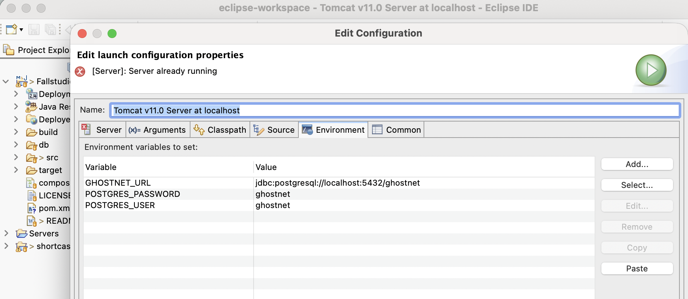

#  Verbindung für Tomcat hinterlegen
In Eclipse öffnest du die Run Configuration deiner Tomcat-Laufzeit und ergänzt im Reiter Environment:
Name	Wert
GHOSTNET_DB_URL	jdbc:postgresql://localhost:5432/ghostnet
GHOSTNET_DB_USER	Dein Datenbankbenutzer
GHOSTNET_DB_PASSWORD	Dein lokal gesetztes Passwort

Werte müssen zu Docker-Datenbank passen. Die .env des Containers wird nicht automatisch von Tomcat übernommen.

---

